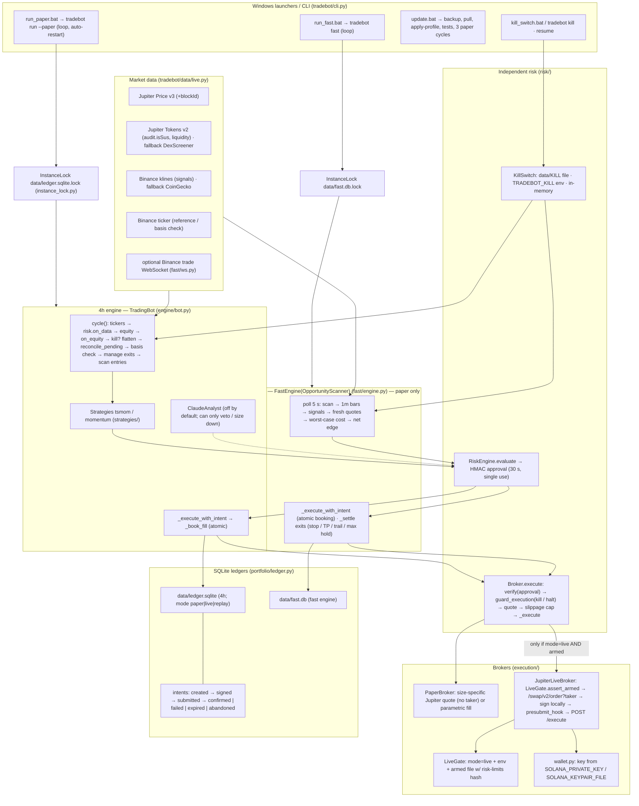

# TRADEBOT production-readiness audit

Date 2026-11-02. Audited code: commit `5ef96a1` (newer than the requested `6d6a6fa`; it adds only the vendored research
skill and its guard test). Fixes from this audit are in the commit that adds this file. Line numbers refer to the code
after the fixes. Mode throughout: **PAPER**. Live trading permissions, strategy configuration, data and secrets were not
changed.

Method: every module on the order path was read; every claim below points at a line. Each fix was written test-first
and confirmed by restoring the original source files and watching its test fail (17 tests fail on the original code,
all pass with the fixes). Live Solana/Jupiter behaviour is exercised with mocked HTTP only; nothing here was observed
against a real chain.

## 1. Architecture (as implemented)

Facts the diagram encodes:
- The **only** route from a strategy to a broker is `_execute_with_intent` → `Broker.execute` (`engine/bot.py:153`,
  `fast/engine.py:194`, `execution/base.py:53`). No other module calls `execute` or `_execute` (grep of the package).
- The fast engine always constructs a `PaperBroker` and refuses `mode=live` (`fast/engine.py:60`, `cli.py:338`).
- Both engines share one kill switch file (`data/KILL`) but have **separate** ledgers and **separate** `RiskEngine`
  instances (`fast/engine.py:66`).
- Claude is outside every execution path; by default it is disabled entirely (`config.py` generated config,
  `profile.py`).

## 2. Safety features

### Implemented and tested

| Feature | Where |
|---|---|
| HMAC risk approval bound to order id, symbol, side, qty, notional; 30 s TTL; per-process secret | `risk/engine.py:106` |
| **Single-use approvals** (new) | `risk/engine.py:121` |
| **Kill switch and daily halt re-checked immediately before quoting/signing** (new) | `risk/engine.py:127`, `execution/base.py:53` |
| Entry limits: position %, total exposure, max open positions, order min/max, cash buffer, 1 % of liquidity, liquidity/volume floors, slippage, trades/day, loss cooldown, loss-streak pause, daily loss, stale data | `risk/engine.py:182` |
| **In-flight buys reserve cash, exposure and a position slot; same symbol refused while in flight** (new) | `portfolio/accounting.py:114`, `risk/engine.py:230` |
| Daily-loss halt (next UTC day) and drawdown kill | `risk/engine.py:145` |
| Stale-data kill, consecutive-error kill | `risk/engine.py:167`, `:173` |
| Kill switch: file, env var, memory; manual reset only; flatten on trip | `risk/kill_switch.py:29`, `:62`; `engine/bot.py:126` |
| **Flatten retried every cycle until the book is flat** (new) | `engine/bot.py:131`, `fast/engine.py:99` |
| Live gate: `mode=live` + `TRADEBOT_LIVE_TRADING` + armed file holding the risk-limits hash; re-checked per order | `execution/live_gate.py:56`, `execution/jupiter_live.py:161` |
| Paper forced by `TRADEBOT_FORCE_PAPER=1`; launchers blank `SOLANA_PRIVATE_KEY` and `TRADEBOT_LIVE_TRADING` | `config.py:236`, `windows/run_paper.bat:10` |
| Durable intent persisted (requestId, signature, signed tx) **before** the network call | `execution/jupiter_live.py:169`, `portfolio/ledger.py:192` |
| Evidence-only reconciliation (signature status + `isBlockhashValid`; time never resolves) | `engine/bot.py:204` |
| **Atomic booking**: fill, position, cash, trade, order status and intent=confirmed commit together (new) | `portfolio/ledger.py:59`, `engine/bot.py:186`, `fast/engine.py:194` |
| **Idempotent reconciliation**: an order that already has a fill is never booked again (new) | `engine/bot.py:227` |
| **Ambiguous Jupiter execute codes → UNKNOWN, never re-signed**; only never-accepted codes re-quote (new) | `execution/jupiter_live.py:32-41`, `:187` |
| Pending intent blocks new orders for that symbol | `engine/bot.py:153` |
| **One engine process per ledger** (OS file lock, released on crash) (new) | `instance_lock.py:21`, `cli.py:76`, `cli.py:341` |
| Startup wallet-vs-ledger balance check (live) trips the kill switch on mismatch | `engine/bot.py:261`, `:589` |
| Jupiter-vs-Binance basis check blocks entries on divergence | `engine/bot.py:327` |
| `audit.isSus` tokens excluded; unpriced mints fail closed | `data/live.py:110` |
| Paper fills from size-specific quotes; quotes over the slippage cap refused | `execution/paper.py:63`, `execution/base.py:58` |
| **Secret backups git-ignored; Claude Code denied reading `.env`, backups, keypairs and running `arm-live`** (new) | `.gitignore`, `.claude/settings.json` |

### Incomplete

| Gap | Where | Consequence |
|---|---|---|
| A reconciled "confirmed" order is booked from the intent's **estimated** qty/notional, not the on-chain amounts | `engine/bot.py:239` | Position size off by the slippage of that fill until the next balance check |
| Wallet-vs-ledger balance reconciliation runs **only at startup**, tolerance 2 % | `engine/bot.py:589`, `config.py:126` | Drift during a session (manual Phantom trade, partial fill, airdrop dust) is not detected until restart |
| Fast engine startup marks **every** pending intent abandoned, including signed ones | `fast/engine.py:80` | Correct for paper (fills never leave the process); wrong if the fast engine were ever given a live broker |
| 4h and fast engines have **separate** risk engines | `fast/engine.py:66` | No combined exposure / daily-loss limit across engines (both paper today) |
| Exit re-quote under a single approval for never-accepted codes | `execution/jupiter_live.py:160` | Safe (original tx was never accepted) but a new transaction is signed without a fresh approval |
| Windows branch of the instance lock (`msvcrt.locking`) | `instance_lock.py` | Verified on Linux only; must be checked once on the PC |

### Missing

| Missing control | Why it matters |
|---|---|
| **Inspection of the transaction before signing** | `JupiterLiveBroker._sign` (`execution/jupiter_live.py:100`) signs whatever base64 transaction `/order` returns. A compromised API response, proxy or DNS could return a transaction that transfers wallet funds elsewhere. Nothing checks fee payer, signer set, program IDs or simulated balance deltas. |
| Alerting | Kill-switch trips, UNKNOWN intents older than 10 min and `booking_failed` are only logged; nobody is notified. |
| RPC redundancy | One RPC URL decides signature status and blockhash validity; an RPC outage leaves intents UNKNOWN (safe) but blocks trading. |
| Key isolation | The signing key lives in the trading process's environment; no separate signer, no OS keychain, no hardware wallet. |

## 3. Paths by which an order could bypass risk approval

| # | Path (before this audit) | Status |
|---|---|---|
| 1 | The same approval could execute the same order more than once within its 30 s TTL (nothing consumed it) | **Fixed**: single use |
| 2 | Kill switch or daily halt tripped after approval but before execution (by the CLI, another process or the risk monitor) — the approval still executed | **Fixed**: `guard_execution` at execute time |
| 3 | Live broker re-quoted and **signed a new transaction** under the original approval after ambiguous codes (`-1000/-1001/-1004/-2000/-2001/-2004`), while the first could still land | **Fixed**: those codes now raise `SubmittedUnknownError`; only `-1` and `-2003` (never accepted) re-quote |
| 4 | Limits evaluated against a book that ignored in-flight orders: an unresolved buy left its cash spendable and its slot free | **Fixed**: reservation in `risk_state` |
| 5 | A second engine process on the same ledger approved orders against its own in-memory book | **Fixed**: instance lock |
| 6 | Reduce-only sells skip entry limits, kill switch and halt | By design: exits must always be possible; quantity is capped at the position (`risk/engine.py:131`, `:182`) |
| 7 | `reconcile_pending` books fills without an approval | By design: it books an order that already executed on-chain |
| 8 | Python code holding the broker object could call `broker._execute` directly | Convention only (private method, no callers). Not exploitable from config or data |
| 9 | Fast and 4h engines each enforce limits on their own book only | Open; harmless while the fast engine is paper-only |
| 10 | Anything else holding the wallet key (the Phantom app, another script) can trade the wallet | Outside TRADEBOT's control; detected only by the startup balance check |

## 4. Crash scenarios

| Crash point | Before | After |
|---|---|---|
| Before signing (intent `created`) | Abandoned on restart; nothing booked | Same (correct) |
| After signing + presubmit, before POST | Intent `signed`; restart: not found → UNKNOWN until blockhash expires → expired; symbol blocked meanwhile | Same (correct) |
| During POST / timeout | `SubmittedUnknownError` → `submitted`; restart confirms or expires on chain evidence | Same (correct) |
| Jupiter returns an ambiguous failure code | Intent marked **failed** (a landed swap was forgotten) **or** a second transaction signed, overwriting the first signature (possible **duplicate buy**, evidence lost) | UNKNOWN with the only signature; chain evidence decides; no second signature |
| After the fill returned, **between intent=confirmed and booking** | Intent terminal, position never booked → **position lost** | Impossible: one transaction; on failure nothing is kept and the intent stays pending with its signature |
| **Midway through booking** (fill row written, position/cash not) | Partial book; reconcile could book again → **duplicate fill** | Rolled back as a unit; reconcile skips any order that already has a fill |
| Two launchers running at once | Both trade the same ledger → **duplicate orders**, double-counted positions | Second process refuses to start (`refusing to start: another process already holds …`) |
| Kill switch trips, first flatten attempt fails | Never retried while the switch stays tripped → **position left open** | Retried every cycle until flat |
| RPC down during restart | Intents stay UNKNOWN, symbol blocked, CRITICAL log after 10 min; manual `resolve-intent` | Same (conservative) |
| Paper process dies after a paper fill but before booking | Paper fill silently lost | Same, and correct: a paper fill exists nowhere else |

## 5. Can positions and pending transactions be reconciled after restart?

**Paper: yes, and it is now consistent by construction.** Positions, cash and intents are reloaded from SQLite; every
booking is atomic; reconciliation is idempotent; a second process cannot interfere. Tested by fault injection
(`tests/test_safety_audit.py`, `tests/test_crash_protection.py`).

**Live: correct in design, not yet proven.** Pending transactions are resolved on chain evidence only and can no longer
be duplicated or forgotten by the paths above. Two limits remain before trusting it with money: a confirmed-on-restart
order is booked at the quoted, not the actual, amounts; and the wallet is compared with the ledger only at startup.
None of this has run against the real chain from this environment.

## 6. Implementation plan

| Priority | Item | Acceptance criteria (measurable) |
|---|---|---|
| **P0 before any live money** | Verify every transaction before signing: fee payer = bot wallet; required signers ⊆ {bot wallet} (plus the JupiterZ maker for RFQ routes); every program ID in an allowlist (Jupiter routers, Token/Token-2022, ATA, Compute Budget, System for ATA rent only); `simulateTransaction` balance deltas limited to −input mint ≤ approved amount and +output mint ≥ min-out | Unit tests: a recorded real Jupiter v2 transaction passes; crafted transactions with a System transfer to a foreign account, an extra signer, or an unknown program are refused before `_sign` is called; 0 false refusals over 50 real quotes captured by `verify-assets` |
| P0 | Book reconciled fills from on-chain amounts (`getTransaction` pre/post token balances) | Mocked `getTransaction`: booked qty equals the on-chain delta to the last decimal; mismatch > 0.5 % logged as an event |
| P0 | Periodic balance reconciliation while live (e.g. every 15 min and after every fill) | Test: a mismatch introduced mid-session trips the kill switch within one interval; no false trip over a 24 h paper soak |
| P0 | Check the instance lock on the Windows PC | Starting `run_paper.bat` twice: the second window prints `refusing to start` and exits with code 3 |
| P0 | Live canary (only after the above and an explicit decision by the owner) | 20 round trips of $5: every intent ends `confirmed`, ledger qty equals wallet balance after each, 0 UNKNOWN older than 5 min |
| P1 | Alerts for kill trip, UNKNOWN > 10 min, `booking_failed`, balance mismatch | Each event produces one notification within 60 s in a test harness |
| P1 | Second RPC, cross-checked for signature status | With the primary RPC failing, reconciliation still resolves a confirmed signature |
| P1 | If the fast engine is ever made live: evidence-based startup reconciliation and one aggregate risk engine across both ledgers | Tests mirror `test_crash_protection.py` for `FastEngine`; combined exposure never exceeds `max_total_exposure_pct` across both books |
| P2 | Move the signing key out of the trading process (separate signer process or OS keychain) | The trading process never has the private key in its environment; signer refuses anything the P0 verifier refuses |
| P2 | Store `JUPITER_API_KEY` in Windows Credential Manager instead of `.env`/`config.toml` | `config.toml` and backups contain no key; preflight still passes |

## 7. Security findings

- **Credentials in git: none.** The user's Jupiter key prefix does not occur in the working tree or in any commit
  (`git log --all -S`); `.env`, `config.toml`, ledgers and the armed file are not tracked.
- **Credential leak path found and closed.** `windows/update.bat` copies `.env` and `config.toml` into `backups/` with
  a timestamp suffix, and `apply-profile` writes `config.toml.bak-*`. None of those names were ignored, so a
  `git add -A` on the PC would have committed the Jupiter key. `.gitignore` now covers `/backups/`, `config.toml.*`,
  `.env.*` (except `.env.example`), `*keypair*.json` and lock files; a test runs `git check-ignore` on each name. The
  backups remain plaintext on disk.
- **No secret is logged.** No code path prints settings, headers or keys; `preflight` reports only whether a key is
  present; wallet addresses are redacted in logs (`execution/wallet.py`).
- **Signing boundary.** The private key is read from the process environment (or a JSON file) into memory of the
  trading process (`execution/wallet.py:21`) only when `mode=live` and the gate is armed (`engine/bot.py:564`).
  Paper launchers blank it. The weak point is not where the key lives but **what it signs**: unverified transactions
  from an HTTP API (P0 above).
- **Claude.** Not in any execution path; disabled by default. When enabled it can only veto or shrink an approved
  signal and choose among backtested parameter sets; it never sees keys, limits or the wallet. Prompt injection via
  market data could at most suppress trades.
- **Third-party skill.** `trader-timemachine` is pinned by hash, has no credentials, no order path, no process launch,
  and is not importable by the engines (`tests/test_vendored_skills.py`). The other ten skills of that pack were
  rejected; brokerage connectors are denied in `.claude/settings.json`.
- **Claude Code permissions** (project settings, deny-only): brokerage MCP servers, the broker script, reading `.env`,
  backups and keypair files, editing/reading the armed file, and running `arm-live`. These restrict Claude, not you;
  the deny rules do not cover a shell `cat .env`, so treat `.env` as readable by any process you run.
- **Signed transactions in the ledger.** `intents.signed_tx` holds signed swap transactions; they are public once
  broadcast and expire with their blockhash (~90 s), so they are not a standing secret.

## Test evidence

| Check | Result |
|---|---|
| Full suite (`python -m pytest`) | **128 passed** |
| Execution selftest (`tradebot selftest`) | **OPERATIONAL, 10/10** |
| New audit tests (`tests/test_safety_audit.py`) | 25 passed |
| Same audit tests against the original source files | 17 **fail** (every code fix is load-bearing). 8 pass: 5 regression guards for codes that were already handled correctly, and 3 whose fixes live in files not reverted for that check (`.gitignore`, `.claude/settings.json`, the new lock module) |
